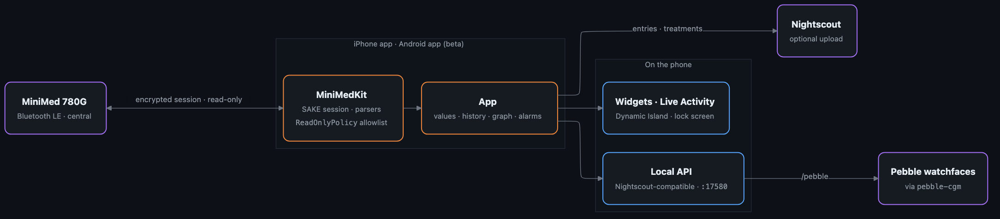

  

<h1 align="center">iPump-mini</h1>

  An open-source app for iPhone and Android (beta) that reads a <b>MiniMed 780G</b> insulin pump <b>strictly read-only</b> over Bluetooth – no manufacturer cloud. 
  <a href="docs/en/getting-started.md"><b>Get started</b></a> · <a href="docs/en/building.md">Build it yourself</a> · <a href="README.de.md">Deutsch</a>

<b>Status:</b> iOS on the App Store · Android beta as APK (Play Store coming) · actively developed

  
  
  

> [!WARNING]
> **Not a medical device. Not for treatment decisions.** Values may be wrong, late or missing. The pump's displays and alarms are always authoritative – keep them on. Not affiliated with or endorsed by Medtronic. Use at your own risk.

## Features
- **Live values every 5 minutes, also in the background:** sensor glucose with trend, active insulin, reservoir, pump battery, SmartGuard state, basal, time in range, sensor status and expiry.
- **Pump history:** boluses, SmartGuard auto corrections, auto basal, carbs, BG and calibrations, suspend/resume. Gaps in the sensor curve are filled from the pump.
- **Graph** (3/6/12/24 h) with treatments and an insulin band. Tap or slide along it for details (time, value, IOB, insulin in that window).
- **Alarms:** urgent low, low, high, rapid changes, pump alerts, “no data”, with snooze and presets.
- **Widgets** for the Home and Lock Screen, **Live Activity / Dynamic Island**.
- **Nightscout upload** (optional) and a **local Nightscout-compatible API** on port 17580 (incl. `/pebble`).
- **German and English**, light/dark, mg/dL or mmol/L, your own target range.
- **First-run setup** with terms of use, a checklist and an in-app guide.
- **Android app** (beta, not yet tested with a pump): [docs/en/android.md](docs/en/android.md).

## Read-only by design
The app never sends commands that change therapy, settings or the state of the pump. Every write to the pump goes through one function and an allowlist of report requests ([`ReadOnlyPolicy.swift`](core/MiniMedKit/Sources/MiniMedKit/Safety/ReadOnlyPolicy.swift)); everything else is blocked and logged. It cannot deliver insulin or clear alarms.

## Get it
| | |
|---|---|
| **iPhone** | [App Store](https://apps.apple.com/de/app/ipump-mini/id6823150975) |
| **Android (beta)** | [APK from GitHub](https://github.com/sgitaize/iPump-mini/releases/latest/download/ipump-mini.apk) – not yet tested with a real pump; the app tells you about new versions; Play Store version coming. Details: [docs/de/android.md](docs/de/android.md) |
| **Build it yourself** | Mac, Xcode and a free Apple ID: [docs/en/building.md](docs/en/building.md) |

Then follow [Get started](docs/en/getting-started.md): accept the terms, load the key database, allow notifications, pair the pump.

## Architecture

Source: <a href="docs/architecture.mmd">docs/architecture.mmd</a> (Mermaid)

**How it works**

The pump is the Bluetooth central, the iPhone the peripheral. After pairing, the pump connects to the app and both negotiate an encrypted session (Medtronic's “SAKE” protocol). Over the same link the app reads the standard Bluetooth services of the pump (Insulin Delivery Service, CGM Service) and their Medtronic extensions. The session is stored, so the app survives updates and restarts without pairing again.

The protocol knowledge comes from **[OpenMinimed](https://github.com/OpenMinimed)** (GPL-3.0). The SAKE implementation in `core/MiniMedKit` is a Swift port of their PythonSake/JavaSake and is tested against a real 780G capture. The SAKE key database is **not** part of this repository or the app; the app loads it from the public OpenMinimed documentation on request.

| Part | Where | What it does |
|---|---|---|
| Protocol library (Swift) | `core/MiniMedKit/` | SAKE session, parsers, read-only allowlist, Nightscout format, tests against a real capture |
| Protocol library (Kotlin) | `core/MiniMedKitKotlin/` | port for Android with the same tests |
| iPhone app | `apps/ios/` | SwiftUI app, widgets, Live Activity, alarms, local API (XcodeGen: `project.yml`) |
| Android app | `apps/android/` | Kotlin / Compose app (beta) |
| Docs | `docs/` | `en/` and `de/` guides and API · `internal/` working notes (German) |
| Research | `research/` | own analysis scripts |

More: [Documentation](docs/README.md) · [Architecture](docs/en/architecture.md) · [API](docs/en/api.md) · [Translating](docs/en/translating.md) · [Working notes](docs/internal/README.md) (German: lab notebook, research, decisions)

## Limitations
- iOS suspends the app between pump updates; the local API does not answer then. For watches, the Nightscout upload is more reliable.
- If the app is swiped away, no more data arrives. A notification reminds you to open it.
- Alarms are time-sensitive notifications; critical alerts (through the silent switch) would need a special Apple entitlement. Allow the app in your Sleep Focus.
- iOS ends a Live Activity after 8 hours. The app starts a new one whenever you open it and can remind you (with quiet hours).
- Tested with one 780G (firmware 6.23W) and Simplera Sync.

## Status & roadmap
- **Live:** iOS 1.0.1 on the App Store, 1.1.0 in review · Android beta 1.0.0 as APK
- **Next:** hardware test of the Android app ([#1](https://github.com/sgitaize/iPump-mini/issues/1)), UI polish ([#2](https://github.com/sgitaize/iPump-mini/issues/2)), Play Store
- Ideas and bugs are welcome as [issues](https://github.com/sgitaize/iPump-mini/issues).

## Legal
Reverse engineering only to achieve interoperability with one's own device (Art. 6 Directive 2009/24/EC, § 69e UrhG) and data access under the EU Data Act (Regulation (EU) 2023/2854). The repository contains only own code and own descriptions (clean room) – no code, keys or assets of the manufacturer. MiniMed, SmartGuard, Guardian, Simplera and CareLink are trademarks of their owners.

## License and credits
GPL-3.0, see [LICENSE](LICENSE). Thanks to [OpenMinimed](https://github.com/OpenMinimed), [Nightscout](https://github.com/nightscout/cgm-remote-monitor) and [xDrip+](https://github.com/NightscoutFoundation/xDrip).

Made by [Simon Gutjahr](https://simongutjahr.de/dev/) · [Imprint](https://simongutjahr.de/impressum/)
