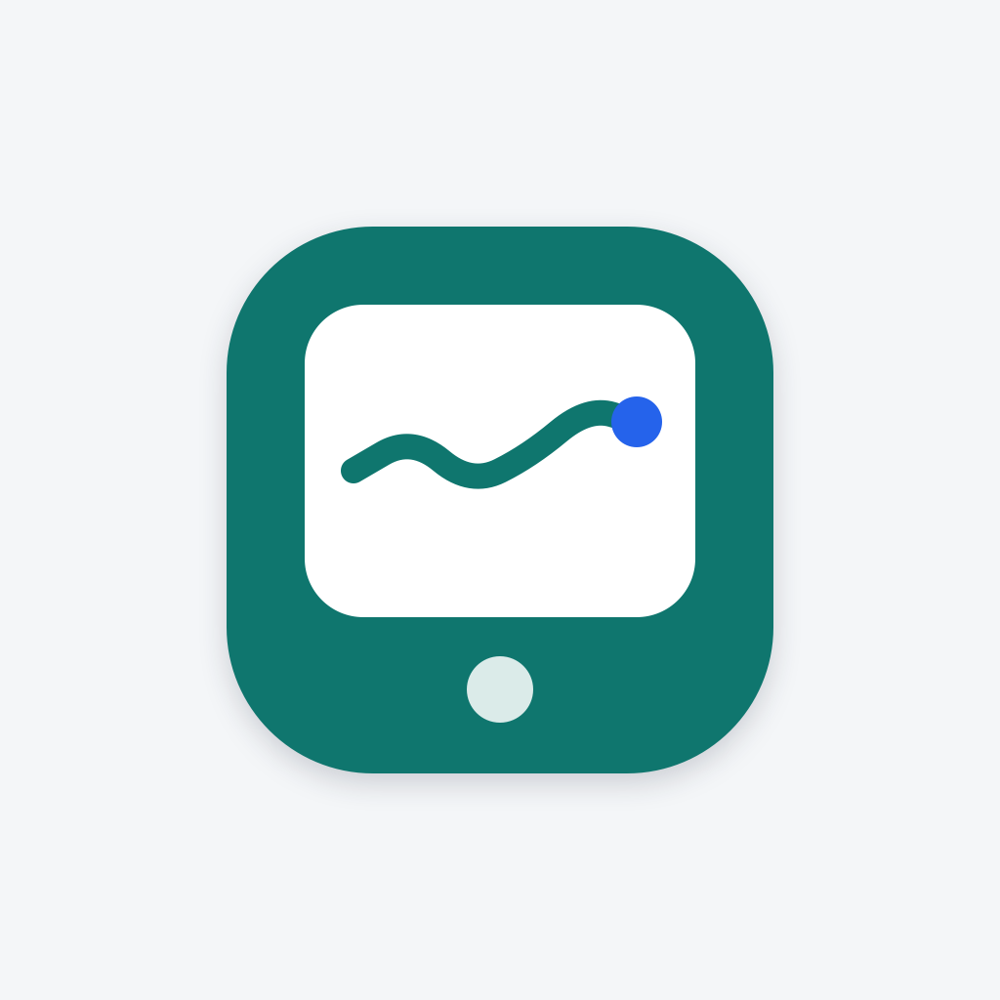
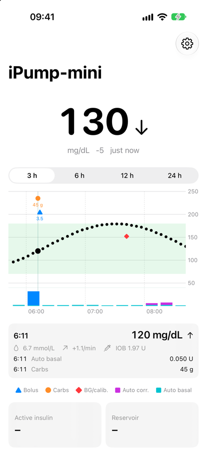
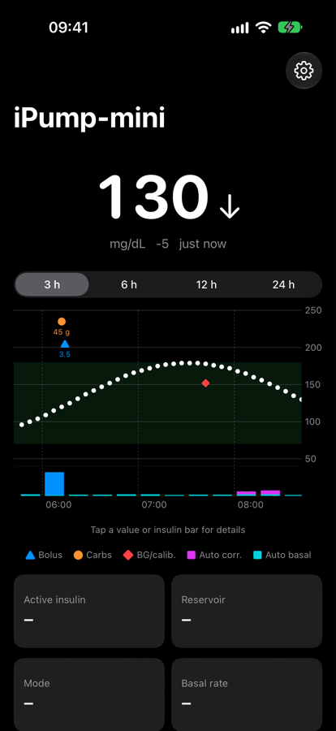
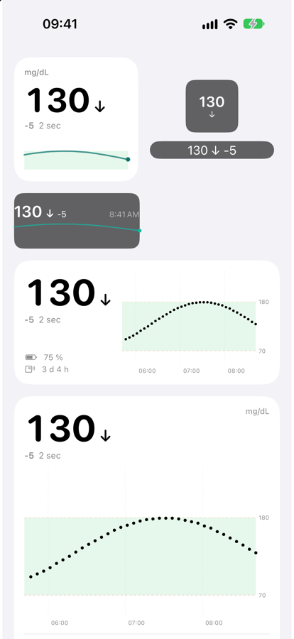

<p align="center">
  
</p>

<h1 align="center">iPump-mini</h1>

<p align="center">
  An open-source iPhone app that reads a <b>MiniMed 780G</b> insulin pump <b>strictly read-only</b> over Bluetooth – no manufacturer cloud.<br>
  <a href="docs/getting-started.md"><b>Get started</b></a> · <a href="docs/building.md">Build it yourself</a> · <a href="README.de.md">Deutsch</a>
</p>

<p align="center">
  
  
  
</p>

> [!WARNING]
> **Not a medical device. Not for treatment decisions.** Values may be wrong, late or missing. The pump's displays and alarms are always authoritative – keep them on. Not affiliated with or endorsed by Medtronic. Use at your own risk.

## Features
- **Live values every 5 minutes, also in the background:** sensor glucose with trend, active insulin, reservoir, pump battery, SmartGuard state, basal, time in range, sensor status and expiry.
- **Pump history:** boluses, SmartGuard auto corrections, auto basal, carbs, BG and calibrations, suspend/resume. Gaps in the sensor curve are filled from the pump.
- **Graph** (3/6/12/24 h) with treatments and an insulin band. Tap or slide along it for details (time, value, IOB, insulin in that window).
- **Alarms:** urgent low, low, high, rapid changes, pump alerts, “no data”, with snooze and presets.
- **Widgets** for the Home and Lock Screen, **Live Activity / Dynamic Island**.
- **Nightscout upload** (optional) and a **local Nightscout-compatible API** on port 17580 (incl. `/pebble`).
- **German and English**, light/dark, mg/dL or mmol/L, your own target range.
- **First-run setup** with terms of use, a checklist and an in-app guide.

## Read-only by design
The app never sends commands that change therapy, settings or the state of the pump. Every write to the pump goes through one function and an allowlist of report requests ([`ReadOnlyPolicy.swift`](core/MiniMedKit/Sources/MiniMedKit/Safety/ReadOnlyPolicy.swift)); everything else is blocked and logged. It cannot deliver insulin or clear alarms.

## Install
- **AltStore / SideStore:** in preparation (see [docs/release-altstore.md](docs/release-altstore.md)).
- **Build it yourself** with a Mac, Xcode and a free Apple ID: [docs/building.md](docs/building.md).

Then follow [Get started](docs/getting-started.md): accept the terms, load the key database, allow notifications, pair the pump.

## How it works
The pump is the Bluetooth central, the iPhone the peripheral. After pairing, the pump connects to the app and both negotiate an encrypted session (Medtronic's “SAKE” protocol). Over the same link the app reads the standard Bluetooth services of the pump (Insulin Delivery Service, CGM Service) and their Medtronic extensions. The session is stored, so the app survives updates and restarts without pairing again.

The protocol knowledge comes from **[OpenMinimed](https://github.com/OpenMinimed)** (GPL-3.0). The SAKE implementation in `core/MiniMedKit` is a Swift port of their PythonSake/JavaSake and is tested against a real 780G capture. The SAKE key database is **not** part of this repository or the app; the app loads it from the public OpenMinimed documentation on request.

## Limitations
- iOS suspends the app between pump updates; the local API does not answer then. For watches, the Nightscout upload is more reliable.
- If the app is swiped away, no more data arrives. A notification reminds you to open it.
- Critical alerts (through the silent switch) need an Apple entitlement; time-sensitive alerts need a paid developer account. Otherwise alarms are normal notifications – allow the app in your Sleep Focus.
- Tested with one 780G (firmware 6.23W) and Simplera Sync.

## Repository
```
apps/ios/          SwiftUI app and widgets (XcodeGen: project.yml)
core/MiniMedKit/   Swift package: SAKE, protocol parsers, read-only allowlist, Nightscout format, tests
docs/              guides, API, protocol notes, decisions (ADRs), lab notebook
research/          own analysis scripts
```
More: [API](docs/api.md) · [Localisation](docs/localization.md) · [Protocol landscape](docs/landscape.md) · [Lab notebook](docs/lab-notebook.md)

## Legal
Reverse engineering only to achieve interoperability with one's own device (Art. 6 Directive 2009/24/EC, § 69e UrhG) and data access under the EU Data Act (Regulation (EU) 2023/2854). The repository contains only own code and own descriptions (clean room) – no code, keys or assets of the manufacturer. MiniMed, SmartGuard, Guardian, Simplera and CareLink are trademarks of their owners.

## License and credits
GPL-3.0, see [LICENSE](LICENSE). Thanks to [OpenMinimed](https://github.com/OpenMinimed), [Nightscout](https://github.com/nightscout/cgm-remote-monitor) and [xDrip+](https://github.com/NightscoutFoundation/xDrip).

Made by [Simon Gutjahr](https://simongutjahr.de/dev/) · [Imprint](https://simongutjahr.de/impressum/)
